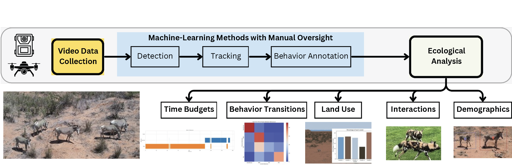
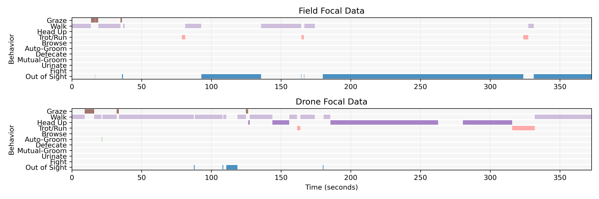
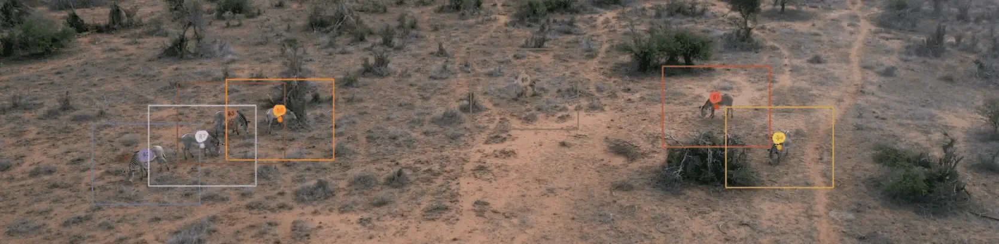

# etho-tools

#### This repository contains tools to analyze *in situ* animal behavior from video.

The modular pipeline processes video through object detection, individual tracking, and machine learning-based behavioral classification to generate ecological metrics including time budgets, behavioral transitions, land use and habitat, social interactions, and demographic data. Framework design enables integration of novel ML models and adaptation across species and study systems.

<details>
  <summary>Click to expand detailed description</summary>

Understanding community-level ecological patterns requires scalable methods to process multi-modal and multi-scalar behavioral data. Traditional field observations are limited in scope, making it difficult to assess behavioral responses across landscapes. To address this, we present Kenyan Animal Behavior Recognition, etho-tools. This open-source computational ecology framework integrates camera-trap and drone video with machine learning to automatically extract behavioral, social, and spatial metrics from wildlife footage.

Our pipeline processes multi-species camera trap and drone data using object detection, tracking, and behavioral classification to generate five key metrics: time budgets, behavioral transitions, social interactions, habitat associations, and group composition dynamics. The modular design allows for integration of novel machine learning models and adaptation across species and study systems. We demonstrate the utility of etho-tools through case studies on zebra time budgets, mixed-species social interactions, and African wild dog individual identification. By automating behavioral monitoring, etho-tools enables scalable ecological research and conservation applications across diverse ecosystems.
</details>


## Overview


**Figure 1:** etho-tools computational framework for automated wildlife behavioral monitoring. 

### 🔧 Installation

`etho-tools` requires **Python 3.10 or 3.11**.

### Basic installation

```bash
pip install -e .
```

### Optional installation modes

- Behavior classification with SlowFast:
  ```bash
  pip install -e ".[slowfast]"
  ```

- Development tools:
  ```bash
  pip install -e ".[dev]"
  ```

- Documentation tools:
  ```bash
  pip install -e ".[docs]"
  ```

- All-in-one (recommended for contributors):
  ```bash
  pip install -e ".[slowfast,dev,docs]"
  ```

> Note: For CUDA-specific `torch` versions, refer to [pytorch.org](https://pytorch.org/get-started/locally/).

## 📖 Project Overview

The Etho tools pipeline consists of:

1. **Video collection using drones and/or camera traps**
2. **Annotation and tracking using CVAT**
3. **Mini-scene extraction**
4. **Behavior classification**
5. **Ecological analysis**

Each script can be run via command-line (`<tool-name> -h`) or imported as a module.

## Documentation

- [User Guide](docs/pipeline/overview.md)
- [Worked Example](docs/pipeline/worked-example.md)
- [CVAT User Guide](docs/cvat/cvat-guide.md)
- [Data Management Tips](docs/cvat/cvat-data-management.md)

## Methodology Comparison and Case Studies

####  See [Methodology Comparison](docs/methodology_comparison/overview.md) for a detailed comparison of different methods for animal behavior analysis, including:
- Focal sampling
- Scan sampling
- Drone-based video analysis

#### See [Case Studies](docs/case_studies/overview.md) for examples demonstrating the application of etho-tools in various ecological contexts, including:
- Grevy's zebra time budgets
- Mixed-species social interactions
- African wild dog individual behavioral monitoring

#### Example time budget analysis output comparing behavior granularity collected from drone videos versus traditional field observations.


**Figure 2:** Time budget comparison between drone-based behavior classification (bottom) and manual field focal observations (top). 

## Citation

If you use this toolkit in your research, please cite both this package and the associated paper (citation details omitted for anonymous review):

**Package citation:**
```bibtex
@software{Anonymous_Etho_Tools_2025,
      author = {Anonymous},
      license = {MIT},
      month = dec,
      title = {{Etho Tools}},
      version = {3.0.0},
      year = {2025}
}
```

**Paper citation:**
```bibtex
@misc{anonymous2025ethotools,
      title={etho-tools: Automated Framework for Multi-Species Behavioral Monitoring}, 
      author={Anonymous},
      year={2025}
}
```

## 💬 Feedback & Issues

Open issues on the project's GitHub repository.

## 🔗 License

This project is licensed under the [MIT License](LICENSE).


