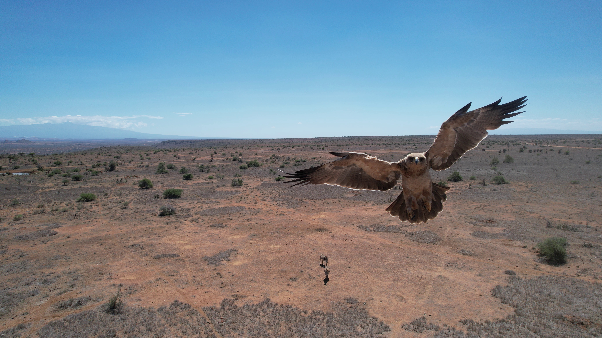

This work was supported by the [Imageomics Institute](https://imageomics.org), which is funded by the US National Science Foundation's Harnessing the Data Revolution (HDR) program under [Award #2118240](https://www.nsf.gov/awardsearch/showAward?AWD_ID=2118240) (Imageomics: A New Frontier of Biological Information Powered by Knowledge-Guided Machine Learning). Additional support was provided by the [AI Institute for Intelligent Cyberinfrastructure with Computational Learning in the Environment (ICICLE)](https://icicle.osu.edu/), funded by the US National Science Foundation under [Award #2112606](https://www.nsf.gov/awardsearch/showAward?AWD_ID=2112606).
 

Any opinions, findings and conclusions or recommendations expressed in this material are those of the author(s) and do not necessarily reflect the views of the National Science Foundation.

 
The [KABR dataset](https://huggingface.co/datasets/imageomics/KABR-raw-videoss) worked examples was collected at the [Mpala Research Centre](https://mpala.org/) in Kenya, in accordance with Research License No. NACOSTI/P/22/18214. The data collection protocol adhered strictly to the guidelines set forth by the Institutional Animal Care and Use Committee under permission No. IACUC 1835F.

The [African wild dog dataset](https://huggingface.co/datasets/imageomics/african_wild_dogs) was collected at [The Wilds](https://thewilds.columbuszoo.org/) in southeastern Ohio, in accordance with the guidelines set forth by the Institutional Animal Care and Use Committee. Research was conducted under Ohio State University IACUC protocol 2022A00000083231 in collaboration with The Wilds animal care staff, with approval from The Wilds Science Committee.

 
Figure: Curious bird inspecting drone at Mpala Research Centre, Kenya. Photo credit: Kline et al., 2023.