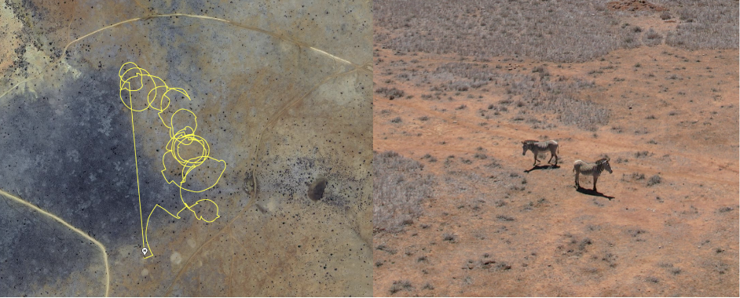
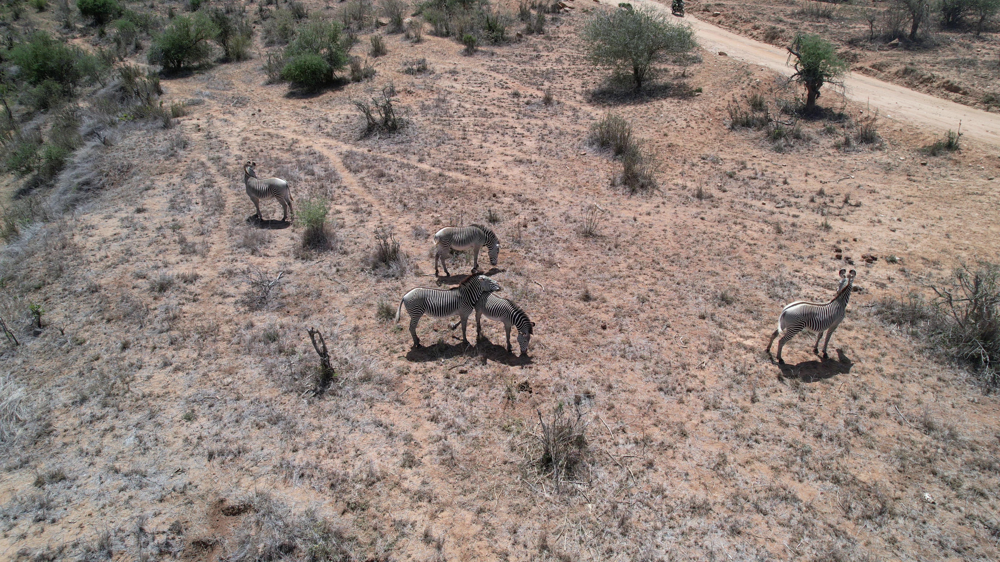
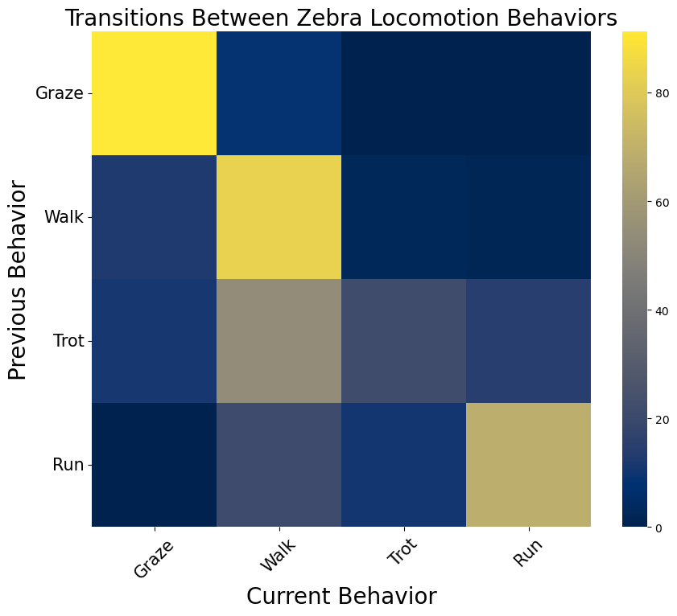
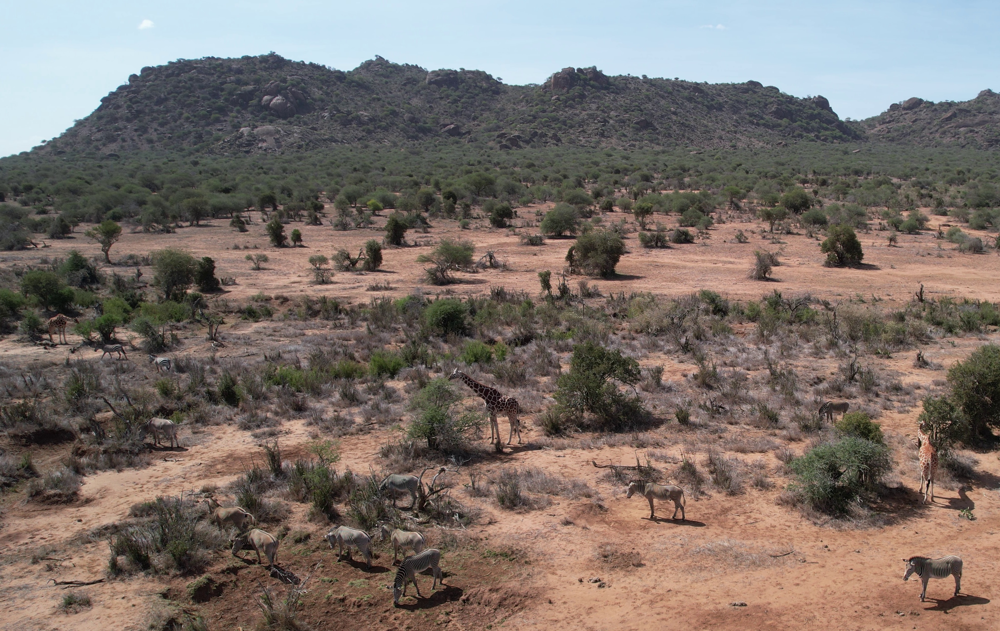
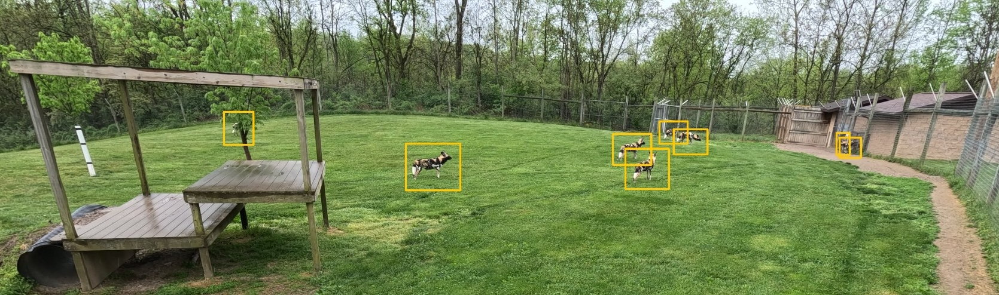

# Case Studies 

We present several case studies demonstrating the application of the etho-tools pipeline for analyzing wildlife behavior from drone and camera trap videos. These case studies illustrate how to generate key ecological metrics and create publication-ready visualizations using the tools provided in this framework.

## Case Study 0: Zebra Time Budgets
Example scripts for creating individual time-budgets and gantt charts from raw video data. See [Time budget notebook](0_time_budget/time_budget.ipynb) for implementation details.

## Case Study 1: Grevy's Landscape of Fear
Comparing effects of herd size and habitat type on the landscape of fear for Grevy's zebras. See the [Grevy's landscape analysis notebook](1_grevys_landscape/grevys_landscape.ipynb) for implementation details (linear regression followed by visualizations).

The time-budget summaries (per bout / per individual) for this case study are available in the[grevystimebudgetscleaned.csv](../../docs/case_studies/1_grevys_landscape/data/grevystimebudgetscleaned.csv) file.

This `grevystimebudgetcleaned.csv` file combines the following dates/sessions published in the [KABR Drone Wildlife Monitoring Dataset](https://huggingface.co/datasets/imageomics/kabr-behavior-telemetry) and [KABR Worked Examples](https://huggingface.co/datasets/imageomics/kabr-worked-examples/) datasets:
- KABR Drone Wildlife Monitoring Dataset: sourced from [`data/consolidated_metadata.csv`](https://huggingface.co/datasets/imageomics/kabr-behavior-telemetry/blob/main/data/consolidated_metadata.csv), specifically the sessions on `11_01_23` , `12_01_23`, and `16_01_23`.
- KABR Worked Examples: sourced from [`behavior/`](https://huggingface.co/datasets/imageomics/kabr-worked-examples/tree/main/behavior), specifically the sessions on `18_01_23`, `20_01_23`, and `21_02_23`.

For both datasets, the dates are the prefixes to the relevant videos.

## Case Study 2: Zebra State Transitions
This case study calculates the transition probabilities for zebra behaviors (Grevy's and Plains). See the [behavior transitions notebook](2_zebra_transition/behaviortransitionsheatmap.ipynb) for implementation details, and the [data on Hugging Face](https://huggingface.co/datasets/imageomics/kabr-behavior-telemetry/blob/main/data/consolidated_metadata.csv) for the data used in this case study.

## Case Study 3: Mixed Species Social Interactions
Here, we calculate the spatial overlap between different species (Grevy's zebras, plains zebras, and giraffes) and visualizes the results. See the [social interactions notebook](3_mixed_species_social/mixed_species_overlap.ipynb) for implementation details, and the [data on Hugging Face](https://huggingface.co/datasets/imageomics/kabr-behavior-telemetry/blob/main/data/consolidated_metadata.csv) for the data used in this case study. The relevant session for this case study is `21_01_2023_session_5`, which is the only session in which all three species were observed together.

## Case Study 4: African Wild Dog Individual Behavioral Monitoring
This case study demonstrates the application of etho-tools for individual behavioral monitoring of African wild dogs from camera trap videos. See the [african wild dog notebook](04_individual_behavior/individual_time_budgets.ipynb) for implementation details, and the [data on Hugging Face](https://huggingface.co/datasets/imageomics/african_wild_dogs) for the data used in this case study. 

