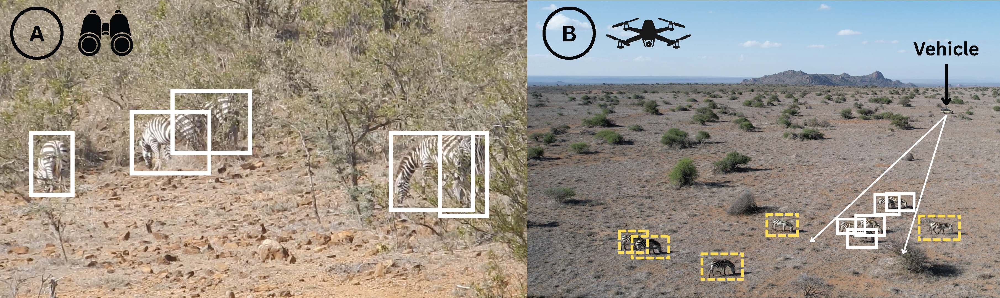
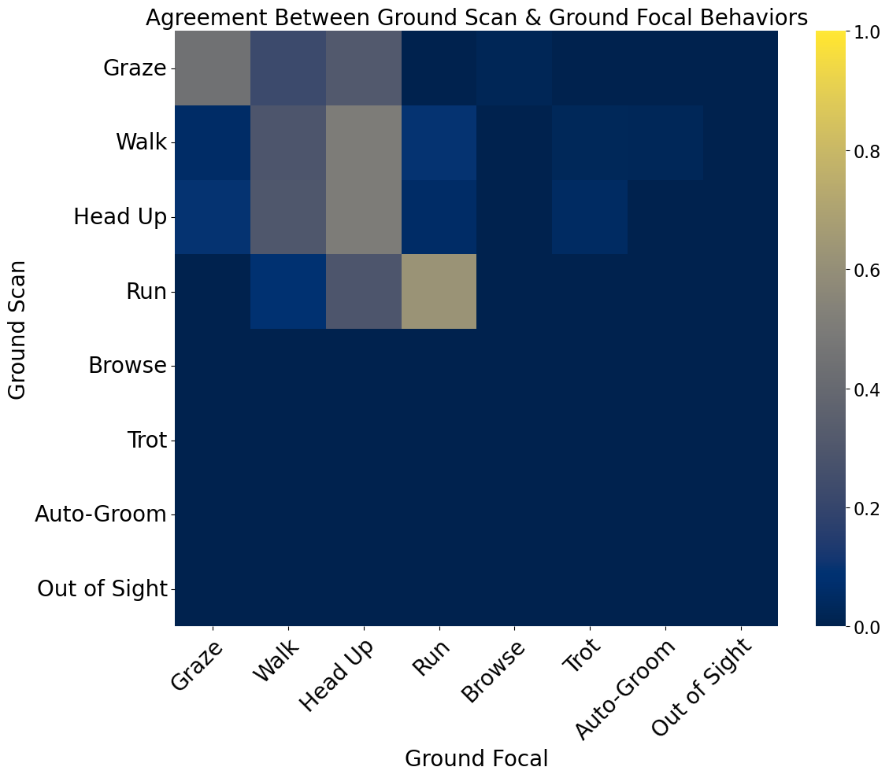
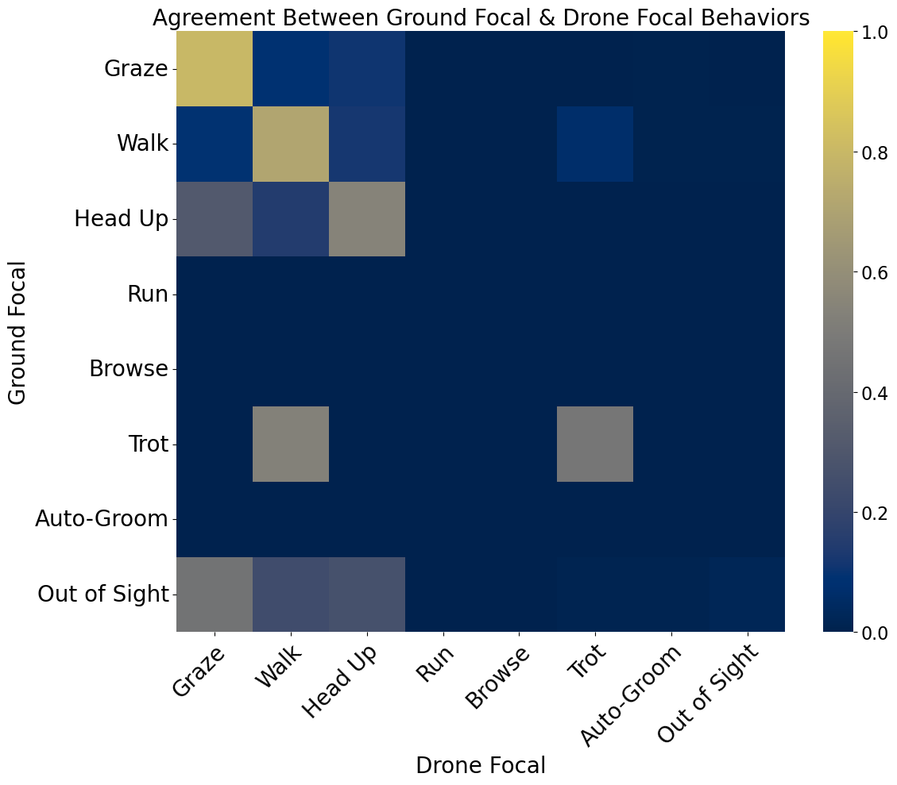
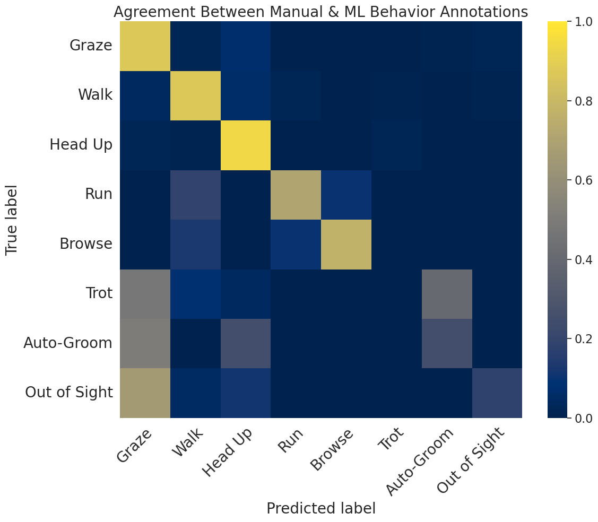

# Scripts for methodology comparison
We provide scripts for comparing different methodologies for animal behavior analysis, including focal sampling, scan sampling, and drone-based video analysis. These scripts allow you to analyze the strengths and limitations of each method and make informed decisions about which approach is best suited for your research questions and study system.

Figure: Example of the same zebra herd viewed from a field vehicle (A) compared to a drone (B), demonstrating the different perspectives and potential behavioral insights gained from each method.

## Scan versus Focal Sampling
Download `scan vs focal` files from the [KABR Methodology Hugging Face dataset](https://huggingface.co/datasets/imageomics/kabr-methodology/tree/main/scanvsfocal) and place them in the `scanvsfocal/data/` directory. See the [scan vs focal notebook](scanvsfocal/analysis/cm-scan-vs-focal-by-species.ipynb) for analysis of the scan versus focal sampling methodology.

Figure: Confusion matrix comparing scan versus focal sampling, showing the agreement between the two methods for different behavioral categories.

## Focal versus Drone Sampling
Download `focal vs drone` files from the [KABR Methodology Hugging Face dataset](https://huggingface.co/datasets/imageomics/kabr-methodology/tree/main/focalvsdrone) and place them in the `focalvsdrone/data/` directory. See the [focal vs drone notebook](focalvsdrone/analysis/cm-focal-vs-drone.ipynb) for analysis of the focal versus drone sampling methodology.

Figure: Confusion matrix comparing focal versus drone sampling, showing the agreement between the two methods for different behavioral categories.

## Manual versus automated behavior labelling comparison
See the [KABR summary notebook](kabr_dataset/data_analysis.ipynb) for analysis of the manual versus automated behavior labelling for drone videos.

Figure: Confusion matrix comparing manual versus automated behavior labelling for drone videos, showing the agreement between the two methods for different behavioral categories.
